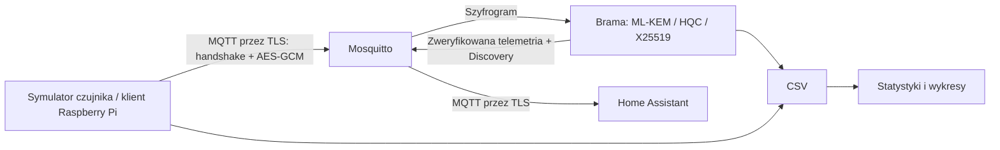

# Bezpieczna komunikacja IoT — MQTT + PQC

Implementacja koncepcji z `bezpieczna_komunikacja_IoT_MQTT+PQC_zalozenia.pdf`.
Jeden Docker Compose uruchamia **Eclipse Mosquitto, Home Assistant, bramę kryptograficzną i symulator czujnika**.
Wykorzystuje rzeczywiste **ML-KEM-768, HQC-128 i X25519**, HKDF-SHA256 oraz AES-256-GCM.
Zawiera benchmarki CSV, raport z wykresami i scenariusze MITM/replay.

To laboratorium badawcze. Symulator zastępuje fizyczny czujnik; pomiary na ESP32/Raspberry Pi wymagają
uruchomienia na tym sprzęcie. Wyników z komputera nie należy opisywać jako wyników ESP32.



## Uruchomienie

Wymagania: Docker Engine / Docker Desktop w trybie **Linux containers** i Docker Compose v2.
Komendy wykonuj w katalogu repozytorium. Pierwsze uruchomienie pobiera obrazy i biblioteki.

```powershell
Copy-Item .env.example .env
docker compose up -d --build
docker compose ps
docker compose logs -f gateway sensor
```

W Linux/macOS zamiast `Copy-Item` użyj `cp .env.example .env`.

Usługa `provision` kończy pracę kodem 0 po utworzeniu losowych haseł MQTT, 32-bajtowego klucza
uwierzytelnienia urządzenia, prywatnego CA i certyfikatu brokera. Kolejne uruchomienia zachowują tożsamości.
Sekrety trafiają do ignorowanego przez Git `runtime/`; nie publikuj tego katalogu.
Niekompletne przygotowanie kończy się błędem zamiast cichego zastąpienia kluczy.
Pliki są czytelne dla grupy wskazanej przez `RUNTIME_GID` (domyślnie `1000`), aby można
było korzystać z nich z hosta. Na Linuksie ustaw w `.env` wynik `id -g`, jeśli Twoja
podstawowa grupa ma inny GID.

- Home Assistant: **http://localhost:8123**.
- Broker: **localhost:8883**, wyłącznie TLS, uwierzytelnianie i ACL; CA: `runtime/public/ca.crt`.
- W sieci Compose broker ma nazwę **mosquitto**, a nie `localhost`.
- Porty hosta domyślnie nasłuchują na `127.0.0.1`.
- Trwałe dane HA i brokera są w wolumenach Docker; dane badawcze w `results/`.

### Podłączenie Home Assistanta

1. Otwórz `http://localhost:8123` i utwórz konto administratora.
2. W **Ustawienia → Urządzenia i usługi → Dodaj integrację → MQTT** wpisz broker `mosquitto`,
   port `8883`, login `homeassistant` oraz hasło z `runtime/homeassistant/mqtt.json`.
3. W zaawansowanych ustawieniach włącz TLS i wybierz **niestandardowy certyfikat CA**.
   Wgraj zawartość `runtime/public/ca.crt` (w kontenerze jest też `/config/certs/ca.crt`).
   Pozostaw sprawdzanie nazwy hosta i walidację certyfikatu włączone; nie wybieraj certyfikatu klienta.
4. Pozostaw MQTT Discovery włączone. Urządzenie **PQC sensor** z sześcioma encjami pojawi się automatycznie.
5. Otwórz **MQTT + PQC** w pasku bocznym: temperatura, wilgotność, algorytm, rozmiar pakietu,
   opóźnienie według zegara i licznik odrzuceń.

Połączenie z brokerem jest konfigurowane przez wspierany interfejs integracji MQTT; konfiguracja YAML
zawiera dashboard. Nie edytujemy wewnętrznych plików `.storage` HA. Jeśli HA miał już encje o tych samych
nazwach, dopasuj ich identyfikatory w dashboardzie.

## Zmiana algorytmu

W `.env` ustaw `ALGORITHM=ml-kem-768`, `hqc-128` lub `x25519`, następnie:

```powershell
docker compose up -d sensor
```

Brama rozpoznaje wybrany algorytm z uwierzytelnionego handshake. HQC nie jest imitowane przez ML-KEM.
Wszystkie trzy warianty używają tego samego transportu, HKDF i szyfrowania, aby umożliwić porównanie.

## Pomiary

Mikrobenchmark kryptografii, bez kosztu MQTT/TLS:

```powershell
docker compose --profile tools run --rm benchmark
docker compose --profile tools run --rm benchmark python -m pqc_iot.benchmark --iterations 200 --sizes 64 256 1024 4096 --output /results/crypto.csv
```

Powstaje `results/crypto.csv`: czasy generacji kluczy, enkapsulacji, dekapsulacji, HKDF,
szyfrowania i deszyfrowania; rozmiary kluczy i szyfrogramu KEM; czas CPU procesu; RSS przed i po iteracji;
informacje o hoście, systemie i Pythonie. Przed pomiarem są 3 pomijane iteracje rozgrzewki dla
każdego algorytmu/rozmiaru (`--warmup`). Plik `crypto.csv` jest nadpisywany przy kolejnym badaniu.
RSS jest pamięcią całego procesu w dwóch punktach, **nie szczytową alokacją algorytmu**.
Pomiar CPU obejmuje proces; w kliencie również wątek obsługi MQTT.

Badanie sieciowe dla wszystkich algorytmów i rozmiarów dopełnienia:

```powershell
python scripts/measure_network.py --count 100 --sizes 0 256 1024 4096
docker compose --profile tools run --rm report
```

Skrypt wymaga działającego stosu. Zatrzymuje ciągły symulator, wykonuje badania pojedynczo i przywraca
symulator w bloku `finally`. Na hoście potrzebny jest tylko Python; kryptografia działa w kontenerach.
Można także uruchomić pojedyncze badanie:

```powershell
docker compose stop sensor
docker compose run --rm --no-deps sensor python -m pqc_iot.device --algorithm hqc-128 --count 100 --padding 1024 --interval 0.1
docker compose up -d --no-deps sensor
```

- `device-<run>.csv`: każda próba, sukces/timeout, RTT potwierdzenia aplikacyjnego, czas handshake,
  rozmiar rzeczywistego JSON szyfrogramu, CPU i RSS.
- `gateway.csv`: zaakceptowane pakiety, sesja, sekwencja, rozmiar JSON i tekstu jawnego, czas według zegara.
- `summary.json`: średnia, mediana, percentyl 95; udział prób bez potwierdzenia.
- `kem-comparison.png`, `network-rtt.png`: porównanie kryptografii i rozkłady RTT.

RTT korzysta z monotonicznego zegara klienta i obejmuje szyfrowanie, MQTT/TLS, bramę i zaszyfrowany ACK.
`clock_latency_ms` to różnica zegarów klienta i bramy; na różnych urządzeniach wymaga synchronizacji NTP
i nie stanowi dokładnego pomiaru jednokierunkowego bez analizy błędu synchronizacji.
Brak ACK oznacza niepotwierdzoną próbę, a nie dowód utraty pakietu IP (MQTT QoS 1 retransmituje).
Rozmiary nie obejmują nagłówków MQTT/TCP/TLS. Do badania ruchu sieciowego użyj dodatkowo tcpdump/Wireshark.
Raport łączy pliki `device-*.csv` w katalogu; archiwizuj poprzednie serie osobno.

## Testy bezpieczeństwa

```powershell
docker compose --profile test run --rm tests
docker compose --profile tools run --rm attacks python -m pqc_iot.attacks --mode replay
docker compose --profile tools run --rm attacks python -m pqc_iot.attacks --mode tamper
docker compose --profile tools run --rm attacks python -m pqc_iot.check_acl
```

Scenariusze replay i tamper wymagają działającego symulatora i wstrzykują jeden pakiet do własnego laboratorium.
Osobne konto `attacker` może czytać i modyfikować transport szyfrowany, ale nie zna PSK ani loginu bramy
i nie ma dostępu do zapisu zweryfikowanych stanów HA.
Sprawdź `docker compose logs gateway` — licznik odrzuceń ma wzrosnąć; kolejny prawidłowy odczyt
aktualizuje ten licznik w HA. Brak ACK w narzędziu jest obserwacją, nie samodzielnym dowodem ochrony.

Test manipulacji wymianą KEM uruchom w drugim terminalu przed restartem symulatora:

```powershell
docker compose --profile tools run --rm attacks python -m pqc_iot.attacks --mode kem-tamper --timeout 90
```

W pierwszym terminalu: `docker compose restart sensor`. Narzędzie przechwytuje wymianę i zmienia
szyfrogram bez poprawnego MAC. Deterministyczne testy automatyczne dodatkowo sprawdzają podmianę
klucza publicznego i algorytmu w ofercie KEM, zły PSK, cudzy nonce, manipulację nagłówkami AES-GCM,
powtórzenie telemetrii, wygaśnięcie sesji i restart bramy.
Szczegóły i granice ochrony opisuje [model zagrożeń](docs/threat-model.md).

## Raspberry Pi i ESP32

Na Raspberry Pi z 64-bitowym Linuxem można uruchomić Compose albo klienta Python bezpośrednio:

```sh
python3 -m venv .venv
. .venv/bin/activate
pip install -r requirements.txt
export MQTT_HOST=<adres-brokera>
export MQTT_PORT=8883
export MQTT_CA=<sciezka-do-ca.crt>
export MQTT_CREDENTIALS=<sciezka-do-mqtt.json-urzadzenia>
export AUTH_KEY_FILE=<sciezka-do-auth.key-urzadzenia>
python -m pqc_iot.device --algorithm hqc-128 --count 100
```

Dla połączenia z innego hosta świadomie zmień mapowanie portu i wystaw certyfikat z SAN odpowiadającym
adresowi/DNS brokera; domyślny certyfikat obsługuje tylko `mosquitto`, `localhost`, `127.0.0.1`.
Nie wyłączaj weryfikacji TLS. Uruchom też benchmark bezpośrednio na Pi, aby porównać CPU/RSS z Dockerem.

ESP32 wymaga osobnej implementacji w firmware i fizycznej walidacji pamięci. Ten projekt realizuje
opisany w PDF **wariant bramy zapasowej**: kryptografia PQC może działać na Raspberry Pi, a ESP32
dostarczać odczyty do tej bramy przez osobno zabezpieczony kanał. Obecnie wejściem są dane symulowane;
transport ESP32 → Pi i firmware nie są zaimplementowane. Nie przypisujemy temu odcinkowi ochrony PQC.
Kolejność pomiarów sprzętowych i szablon raportu: [metodyka](docs/experiments.md).

## Rozwój i diagnostyka

```powershell
python -m venv .venv
.\.venv\Scripts\python.exe -m pip install -r requirements-dev.txt
.\.venv\Scripts\python.exe -m pytest -q
.\.venv\Scripts\ruff.exe check .
docker compose config --quiet
```

CI uruchamia testy oraz rzeczywisty MQTT/TLS dla trzech algorytmów na Linuxie.
Gdy brama zostanie zrestartowana, klient po braku ACK rozpoczyna nowy handshake; stare szyfrogramy
nie mają aktywnej sesji. Sesja odnawiana jest przed upływem 240 sekund. Krótkie przerwy MQTT uruchamiają
ponowne połączenie i subskrypcje. `docker compose ps` pokazuje stan healthchecków.

`docker compose down` zatrzymuje stos i zachowuje dane. Zmiana haseł/CA wymaga zaplanowanej rotacji
`runtime/` i ponownej konfiguracji MQTT w HA; nie usuwaj sekretów przy zwykłym restarcie.
Certyfikat serwera wygasa po 825 dniach. Przy zmianie uprawnień lub niekompletnym `runtime/` sprawdź
logi `provision` i przywróć spójną kopię katalogu. Przy badaniach na Linuxie usługi aplikacji używają UID 10001.

Dokumentacja referencyjna:
[Mosquitto](https://mosquitto.org/man/mosquitto-conf-5.html),
[MQTT w Home Assistant](https://www.home-assistant.io/integrations/mqtt/),
[Home Assistant Container](https://www.home-assistant.io/installation/linux),
[API pqcrypto 0.3.4](https://pypi.org/project/pqcrypto/0.3.4/).
Wersje zależności są przypięte, w tym API `pqcrypto` (nowsze 1.x ma inne nazwy funkcji).
